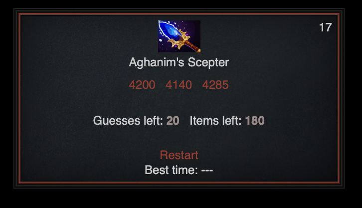

# [Try it out here!](https://pedruu.ch/games/dota_items)

Guess the correct price off the dota items, to win the game. Inspired by the "shopkeeper's quiz" game.

# Commands

- `pnpm install --frozen-lockfile` - install the dependencies.
- `pnpm dev` - start the development build and run a local server.
- `pnpm build` - Run the release build.

# Attribution

- Sounds/images are part of the game [dota2](https://www.dota2.com/).
